# 提个词 CueGlide

一款只做提词的 iOS 原生应用。免费、开源、离线、无账号。

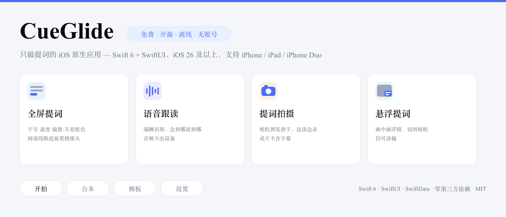

用 Swift 6 与 SwiftUI 编写，支持 iOS 26 及以上，适配 iPhone、iPad 与 iPhone Duo 折叠屏。

<p>
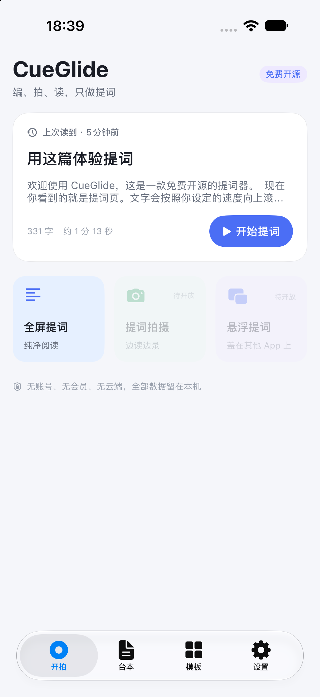
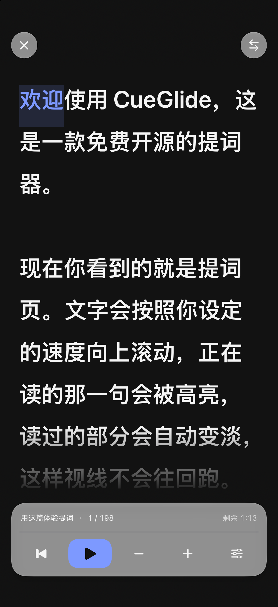
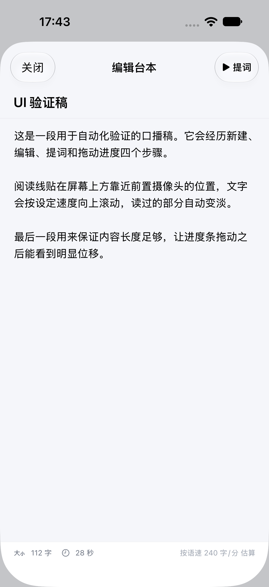
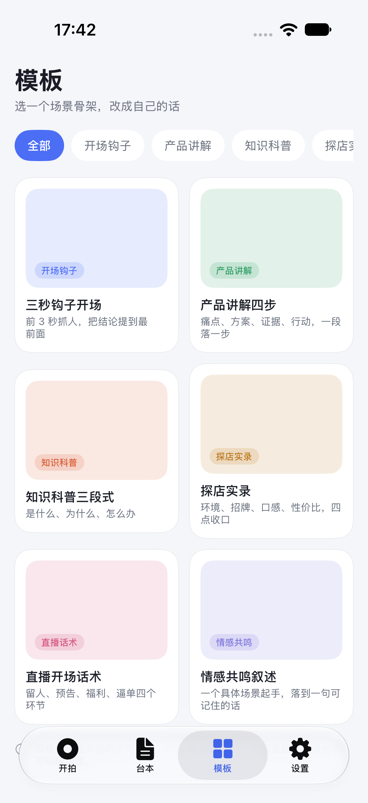
</p>

<details>
<summary>更多界面截图</summary>

<p>
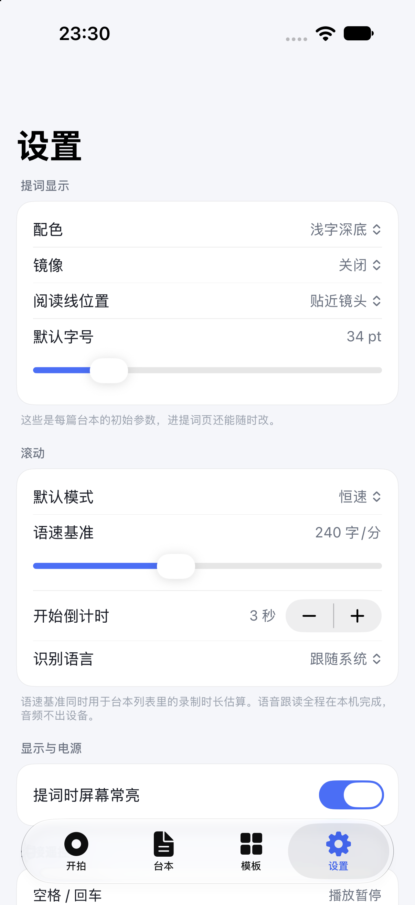
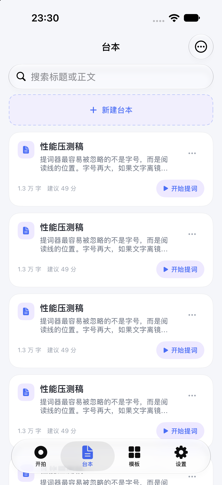
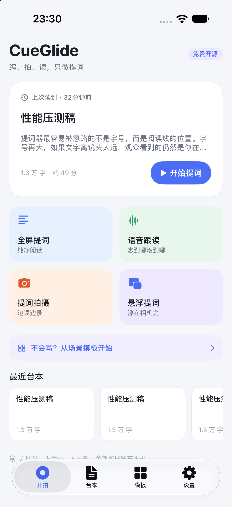
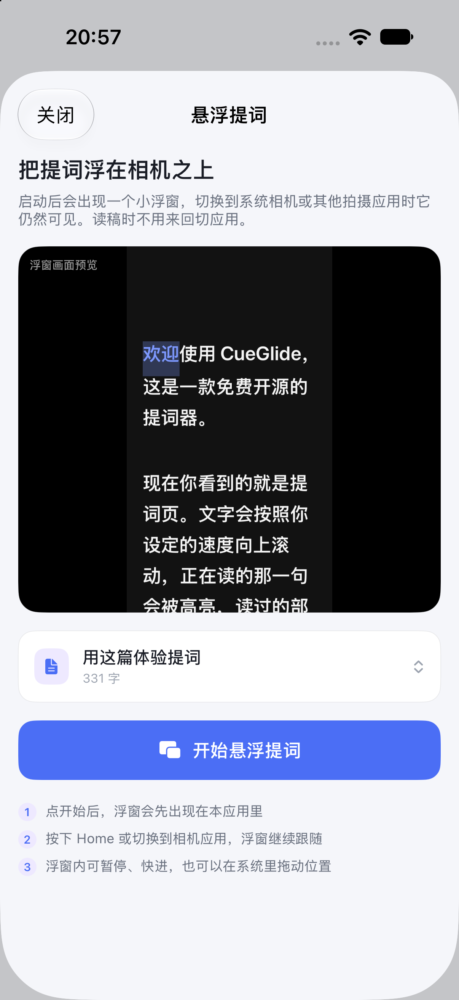
</p>

<p>
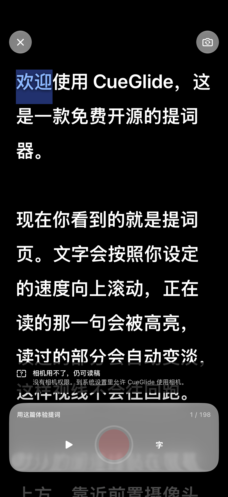


</p>

<p>

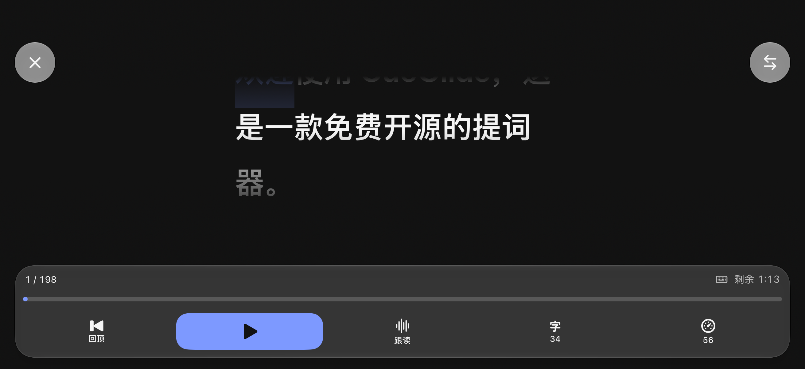
</p>

<p>
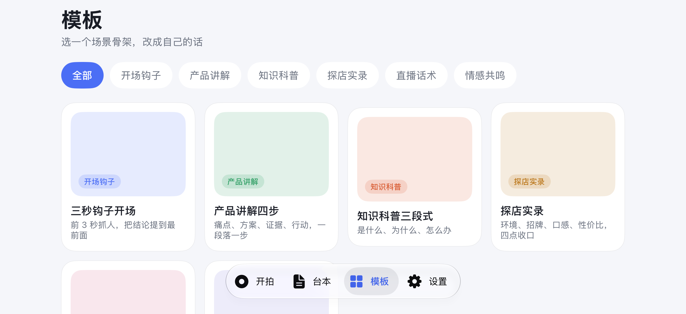
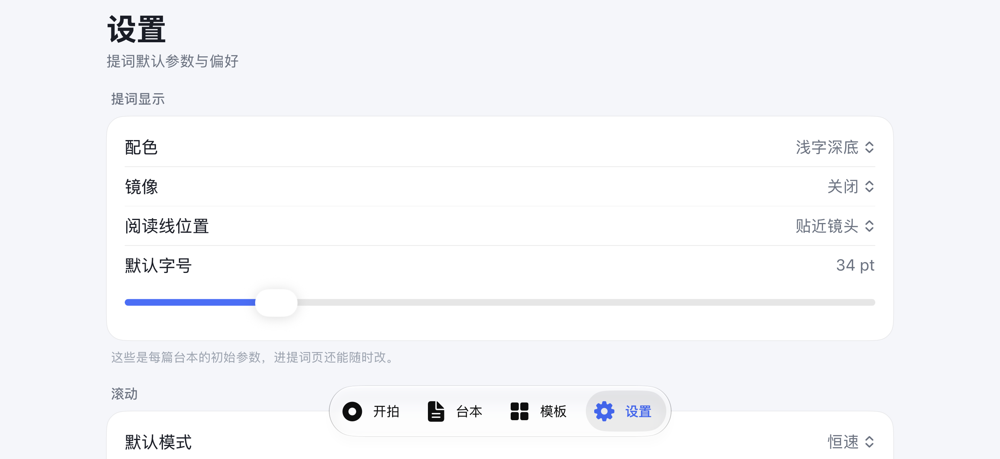
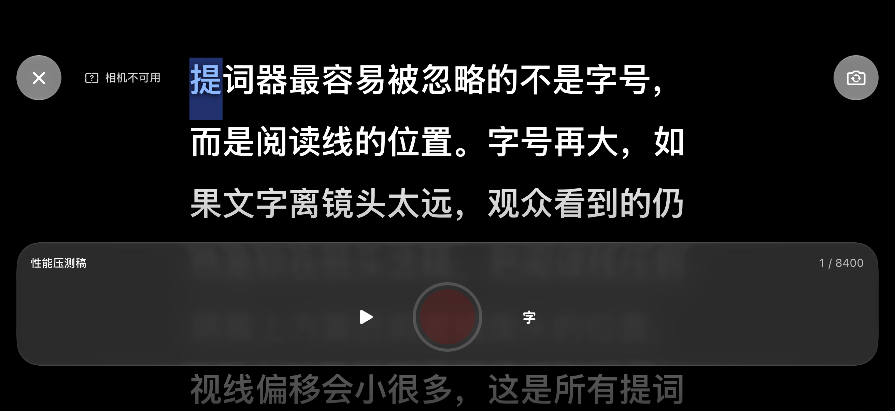
</p>

</details>

## 下载

### TestFlight（公开测试）

**不需要提交邮箱或 Apple ID**，点开公开链接就能加入：

> **加入链接：** `（待填：App Store Connect → TestFlight → 外部测试 → 公开链接）`

在 iPhone 上点开链接 → 跳转 TestFlight → 点「安装」。名额上限 10000 人。

遇到问题直接在本仓库提 Issue 或 PR，一起改。

### App Store

审核通过后补充商店链接。

## 怎么用

1. **新建台本** —— 首页右下角「＋」，粘贴或输入要念的内容；也可以从模板库挑一个场景骨架
2. **开始提词** —— 点台本进入提词页，默认就是语音跟读模式，直接念即可，念到哪滚到哪
3. **调顺眼** —— 控制条上「字号」「速度」就地展开滑块；阅读线位置、镜像、配色在设置里改

第一次进提词页会请求麦克风与语音识别权限，用于跟读定位。音频全程留在设备上。

### 会不会录进去

提词页只是显示，不录音。要边读边录，用**提词拍摄**：相机画面在下、提词文字在上，成片只有画面不含字幕。

## 功能

**已经能用**

- 台本管理：新建、编辑、搜索、四维排序、字数统计、朗读时长估算、断点续读
- 台本导入：从粘贴板或文件导入，自动识别 UTF-8 与 GB18030，标题取首行
- 提词显示：字号、字重、行距、边距、五套配色、阅读线位置、阅读参考线
- 镜像：水平、垂直、双向，适配分光镜提词器；镜像时控制条保持正向
- 滚动：恒速、语速（字/分）、定时（给定总时长）、**语音跟读**四种模式
- 语音跟读：端侧识别，念到哪里滚到哪里，跳段后能找回，音频不出设备。**进入提词页即自动跟随**
- 提词页直接调速调字号：控制条上点「字号」「速度」就地展开滑块
- 手势：双击暂停，上下滑手动滚动，左右滑调速
- 进度跳转：拖动进度条跳到任意位置，松手继续滚
- 外接遥控：蓝牙演示器、翻页笔、脚踏开关、外接键盘；空格播放暂停、方向键调速与跳词
- 逐词高亮：当前词高亮，已读部分自动变淡
- 提词拍摄：相机预览叠提词，边读边录，成片不含字幕，录完进相册
- 悬浮提词：提词画面做成画中画浮窗，切到其他应用仍可见
- 台本模板：6 个内置场景骨架 + 自定义模板（可新建、编辑、换配图，配图可选 15 张内置图库或从相册上传）；没有思路时可复制内置提示词去任意 AI 生成，粘回来自动填入
- 多设备：iPhone 竖屏与横屏、iPad、iPhone Duo 内外屏，按尺寸类适配

**规划中**

- 外接屏与 AirPlay 输出
- Apple Watch 与锁屏控制
- 半折叠分屏：上半屏读稿，下半屏放控制
- 字幕导出

## 系统要求

| 项 | 要求 |
|---|---|
| 系统 | iOS 26.0 及以上 |
| 设备 | iPhone、iPad、iPhone Duo |
| 相机 / 画中画 | 需要真机，模拟器不提供 |
| 自己编译 | macOS + Xcode 27.0 及以上 |

## 自己构建

开源仓库不附带证书，需要用自己的 Apple ID 签名。

```bash
brew install xcodegen
git clone https://github.com/symi-daguo/cueglide.git
cd cueglide
xcodegen generate
open CueGlide.xcodeproj
```

然后在 Xcode 里：

1. 选中 `CueGlide` target → **Signing & Capabilities** → Team 选自己的账号
2. **Bundle Identifier 改成唯一值**，例如 `com.你的名字.cueglide`（`com.symi.cueglide` 被官方版占用，你签不了）
3. `CueGlideTests` 与 `CueGlideUITests` 两个 target 的 Bundle ID 也要一起改，保持「主 ID + .tests / .uitests」的前缀
4. 连上真机，选设备后 `Cmd+R`

**免费 Apple ID 的限制**：签名 7 天过期，到期后重新运行一次即可，App 数据不受影响。相机、麦克风、语音识别这些权限免费账号都能用，**不需要付费开发者账号**。

更细的架构与算法说明见 [docs/设计说明.md](docs/设计说明.md)。

## 参与贡献

见 [CONTRIBUTING.md](CONTRIBUTING.md)。PR 合并后 GitHub 会自动列入 Contributors；TestFlight 用公开链接，不需要交邮箱。

## 合规

- 不含第三方 SDK，不联网，不做统计与埋点
- 相机、麦克风、语音识别的数据全部在设备本地处理
- 权限用途在首次使用对应功能时才请求，`Info.plist` 里的用途说明与实际用途一致
- 隐私清单 `PrivacyInfo.xcprivacy` 已声明：无追踪、无数据收集

## 协议

[MIT](LICENSE)。

## 隐私

见 [PRIVACY.md](PRIVACY.md)。
