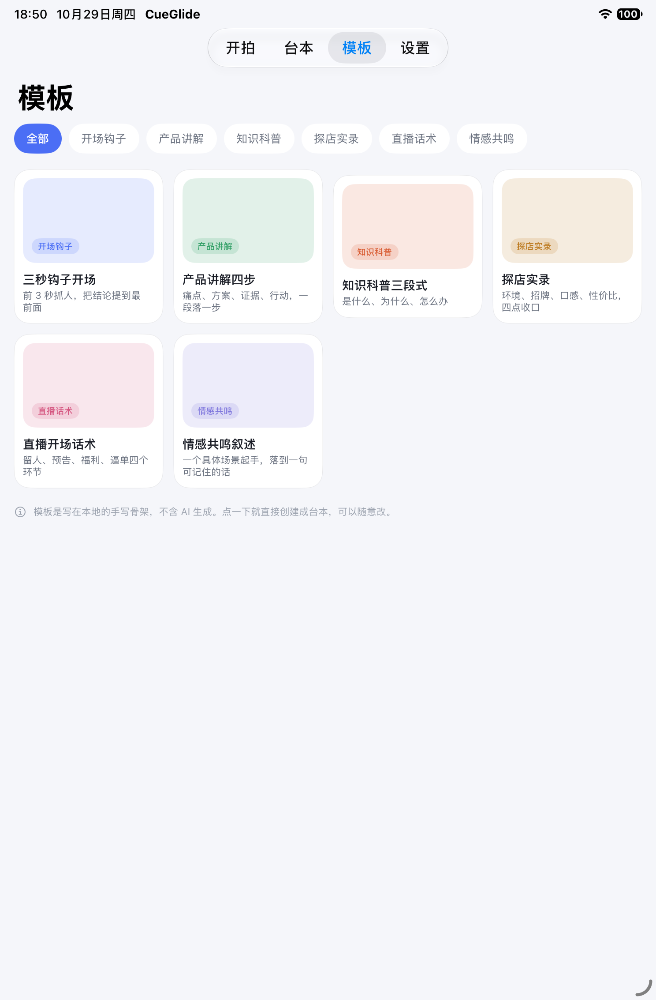

# CueGlide

一款只做提词的 iOS 原生应用。免费、开源、离线、无账号。

用 Swift 6 与 SwiftUI 编写，基于 iOS 26 及以上，支持 iPhone、iPad 与 iPhone Duo 折叠屏。

<p>



</p>

## 为什么又一个提词器

市面上大多数提词器把语音跟读、镜像、外接屏这些核心能力放在付费墙后面，剩下的功能又堆满了 AI 写稿和数字人。

CueGlide 的方向相反：只做读稿这一件事，把它做扎实，全部免费，代码公开。

## 功能

**已经能用**

- 台本管理：新建、编辑、搜索、四维排序、字数统计、朗读时长估算、断点续读
- 提词显示：字号、字重、行距、边距、五套配色、阅读线位置、阅读参考线
- 镜像：水平、垂直、双向，适配分光镜提词器；镜像时控制条保持正向
- 滚动：恒速、语速（字/分）、定时（给定总时长）三种模式，支持倒计时、暂停、跳回
- 手势：双击暂停，上下滑手动滚动，左右滑调速
- 逐词高亮：当前词高亮，已读部分自动变淡，视线不会往回跑
- 台本模板：6 个场景骨架，纯本地手写，不含 AI 生成
- 多设备：iPhone 竖屏、iPad、iPhone Duo 展开与折叠

**规划中**

- 端侧语音跟读：跟着念到哪里滚到哪里，跳段后能找回
- 悬浮提词：画中画浮层，盖在其他相机应用上
- 提词拍摄：边读边录，成片不含字幕
- 遥控：蓝牙键盘、演示器、脚踏、音量键
- 外接屏与 AirPlay 输出
- 字幕导出

## 系统要求

| 项 | 要求 |
|---|---|
| 系统 | iOS 26.0 及以上 |
| 开发 | Xcode 27.0 及以上，Swift 6 |
| 设备 | iPhone、iPad、iPhone Duo |

## 构建

项目文件由 [xcodegen](https://github.com/yonaskolb/XcodeGen) 从 `project.yml` 生成。

```bash
brew install xcodegen
git clone https://github.com/symi-daguo/cueglide.git
cd cueglide
xcodegen generate
open CueGlide.xcodeproj
```

在 Xcode 中选择 `CueGlide` scheme 与目标设备，按 `Cmd+R` 运行。

也可以直接用命令行构建：

```bash
xcodebuild -project CueGlide.xcodeproj \
  -scheme CueGlide \
  -destination 'platform=iOS Simulator,name=iPhone 18 Pro' \
  build
```

安装到自己的设备时，需要在 Xcode 的 Signing & Capabilities 里选择自己的开发者账号，并把 Bundle Identifier 改成唯一值。

## 项目结构

```
CueGlide/
  App/              入口与标签页导航
  DesignSystem/     颜色、字体、格式化等视觉 token
  Models/           台本、显示配置、滚动配置、模板
  Core/
    PromptEngine/   分词索引、滚动引擎、文本渲染
    Speech/         语音跟踪（规划中）
  Features/
    Home/           开拍首页
    Scripts/        台本列表与编辑
    Prompter/       提词页
    Templates/      模板库
    Settings/       设置
docs/
  设计说明.md        产品边界、界面规格、核心算法、技术选型
  screenshots/      界面截图
```

## 设计要点

三个决定读稿体验的细节，完整说明见 [docs/设计说明.md](docs/设计说明.md)：

1. **坐标用词索引，不用像素**。换字号、换行距、折叠屏展开后重排，阅读进度都不会丢。
2. **阅读线贴合前置摄像头**。视线尽量接近镜头轴心，观众才不觉得你在低头念稿。
3. **宽屏限制阅读列宽**。一行排到十几个词时，视线扫视距离过长会拖慢朗读节奏。

## 参与贡献

欢迎提 Issue 和 PR。提交前请先看 [CONTRIBUTING.md](CONTRIBUTING.md)。

## 协议

[MIT](LICENSE)

## 隐私

不收集任何数据，不接入埋点与广告 SDK，不请求网络。台本、设置、录像全部存放在设备本地。

唯一会联网的动作，是你主动点击设置页的「问题反馈」时打开浏览器。
