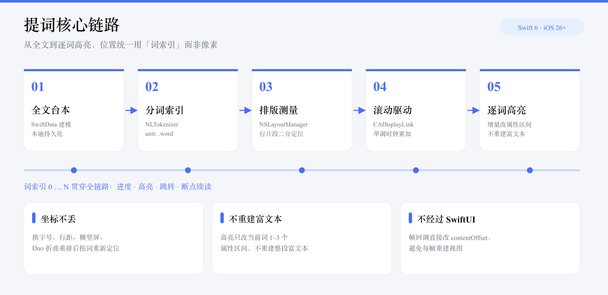
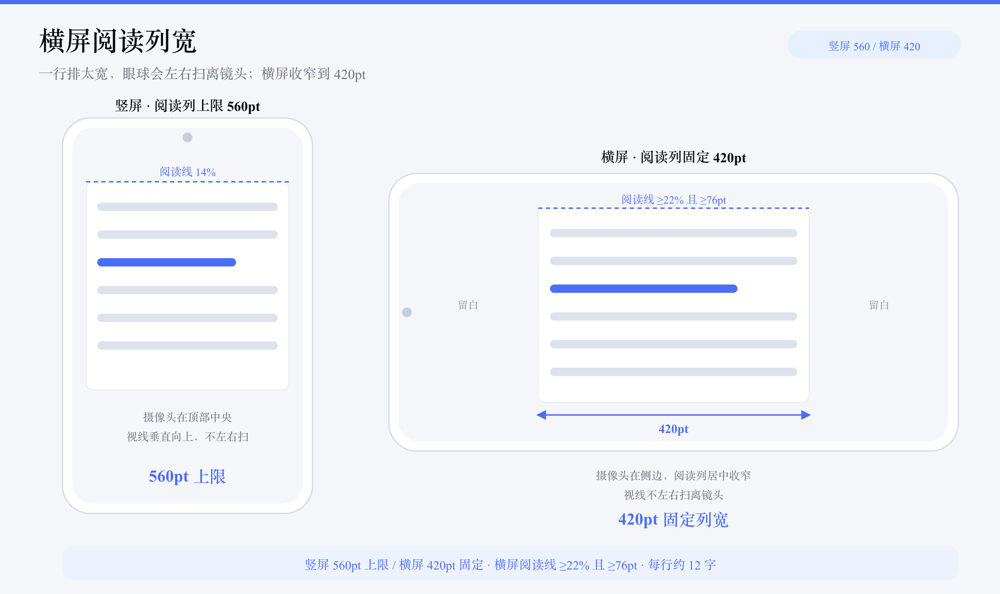
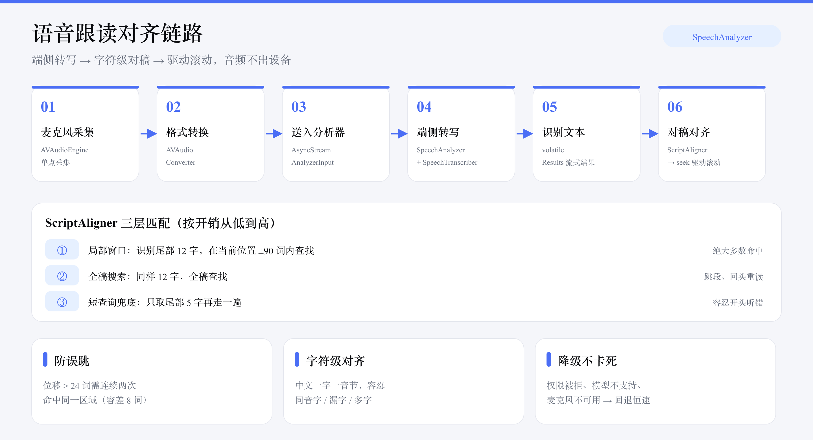
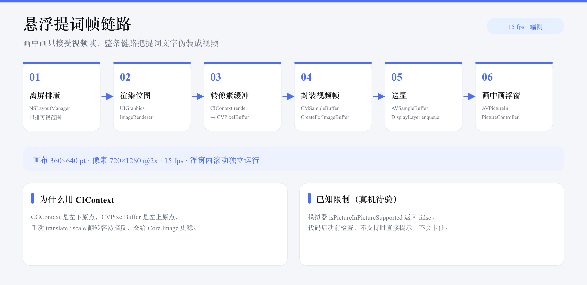
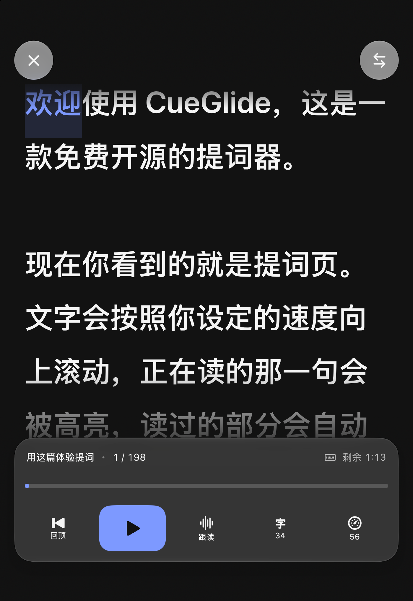
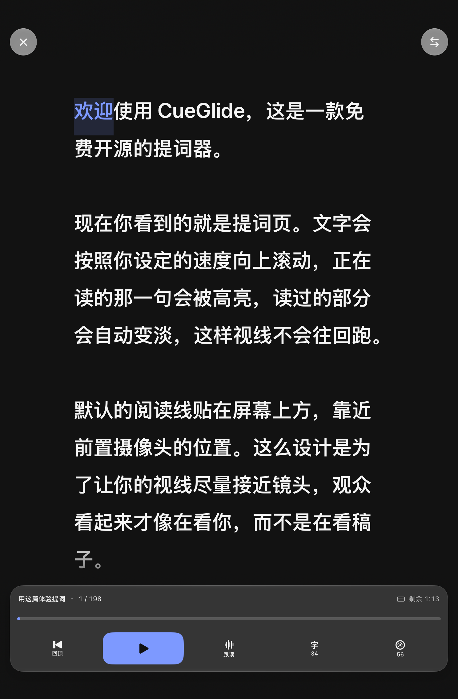

# CueGlide 设计说明

本文记录 CueGlide 的产品边界、界面规格、核心算法与技术选型，供后续开发与二次开发参考。

- 版本：0.6.28
- 更新：2026-10-31
- 平台：iOS 26.0 及以上

---

## 1. 项目定位

一款只做提词的 iOS 原生应用。免费、开源、离线、无账号。

设计上的三个取舍贯穿全文：

1. **只做提词**。不做剪辑、不做 AI 生成内容、不做直播推流。功能一旦越界，提词本身就会被稀释。
2. **离线优先**。所有数据留在设备上，不请求网络，不需要登录。
3. **读稿体验优先于功能数量**。阅读线位置、字号、行距、滚动平滑度这些细节，比多十个按钮重要。

---

## 2. 功能范围

### 2.1 做什么

| 模块 | 内容 |
|---|---|
| 台本管理 | 新建、编辑、搜索、排序、删除、字数统计、朗读时长估算、断点续读 |
| 提词显示 | 字号、字重、行距、边距、五套配色、水平/垂直/双向镜像、阅读线位置、阅读参考线 |
| 滚动 | 恒速、语速（字/分）、定时（给定总时长）、语音跟读、倒计时、暂停、跳回、手动拖拽、进度跳转 |
| 逐词高亮 | 当前词高亮，已读部分自动变淡 |
| 拍摄 | 相机预览叠字、录制、存入相册、字幕不烧录；录制时禁用语音跟读（共用麦克风） |
| 遥控 | 蓝牙键盘、演示器、脚踏、外接键盘；音量键与锁屏控制未做 |
| 模板 | 6 个场景化的台本骨架，纯本地手写 |

### 2.2 明确不做

| 项 | 原因 |
|---|---|
| AI 写稿、AI 生成封面、AI 抠像 | 需要云端算力，与离线定位冲突 |
| 数字人、AI 生成视频 | 属于内容生产，不属于提词 |
| 视频剪辑、字幕烧录 | 剪辑是另一个产品，录完交给系统相册或专业剪辑软件 |
| 账号、会员、付费墙 | 开源项目没有收入模型，也不需要用户数据 |
| 云同步、多端协作 | 数据留在本机是隐私承诺，不是功能缺失 |
| 直播推流 | 与提词器本体解耦，且需要第三方平台授权 |
| 分光镜梯形校正 | 市面分光镜设备均为固定 45 度直角，需要的是镜像而非透视校正 |

---

## 3. 信息架构

底部四个标签页：

| 位置 | 名称 | 内容 |
|---|---|---|
| 1 | 开拍 | 续读入口、全屏提词 / 语音跟读 / 提词拍摄 / 悬浮提词四个快捷入口、场景模板入口、最近台本 |
| 2 | 台本 | 台本列表、搜索、排序、新建、编辑 |
| 3 | 模板 | 按场景分类的台本骨架 |
| 4 | 设置 | 提词默认参数、滚动默认值、语速基准、屏幕常亮、关于 |

主页面共 8 个：开拍首页、台本列表、台本编辑、提词页、悬浮提词页、提词拍摄页、模板库、设置。字号与速度滑块、进度条在提词页内联展开，不是独立页面。

编辑页在键盘上方提供「收起键盘」。长稿写到一半想看一眼整体，或者准备点「提词」，都需要先把键盘落下；没有这个入口时只能靠下滑或点空白，长稿上不一定有效。

---

## 4. 提词页版面规格

提词页是全屏沉浸式布局，与其余页面视觉体系完全解耦。

### 4.1 竖屏分区

| 区域 | 位置 | 内容 |
|---|---|---|
| 顶部 | 安全区下方 8pt 起 | 关闭按钮、镜像切换 |
| 阅读区 | 约 62% | 滚动文本，首行位于阅读线上 |
| 阅读线 | 距顶部约 14% | 视觉锚点，默认贴近前置摄像头，可在设置中关闭参考线 |
| 底部控制区 | 约 20% | 进度、剩余时长、播放、字号、设置 |

### 4.2 视觉规则

1. 阅读线默认贴近前置摄像头，让视线尽量接近镜头轴心，避免观众看出在读稿。
2. 文本区上下各设渐隐遮罩。顶部渐隐高度等于阅读线位置（屏高约 14%），底部 260pt，避免文字硬切边缘。
3. 控制条播放后 3 秒自动淡出，点按屏幕唤回；淡出时保留进度指示。
4. 镜像只作用于文字层，控制层保持正向；点击坐标反算回原坐标系。
5. 已读文字降到 32% 不透明度，当前词高亮并加浅色背景块，未读保持主文字色。
6. 提供五套提词专用配色：深字浅底、浅字深底、纯白高对比、黄字黑底、绿字黑底。这些配色不受系统深色模式影响。

### 4.3 滚动状态机

```
idle → playing ⇄ paused → finished
        ↘ 手动拖拽（临时进入 dragging，松手回到 playing）
```

关键约束：

- 位置用「词索引」表示，不用像素偏移，换字号或换行距后阅读进度不丢。
- 变速使用 0.2 秒缓动插值，避免速度阶跃造成视觉跳动。
- 任意时刻点按文本行，跳到该词并从此处继续。
- 切后台自动暂停，回前台询问继续还是重来。

---

## 5. 核心算法



全文从分词到逐词高亮是一条单向链路，位置统一用词索引表示。`images/` 下每张图都保留 SVG 矢量源（中文用系统字体渲染），改完可用 `rsvg-convert -w 2880 -o 名称.png 名称.svg` 重新导出 2x PNG。

### 5.1 分词与坐标系统

全文统一使用「词」作为坐标单位，像素只是渲染结果。

分词使用 `NLTokenizer(unit: .word)`，中文按词、西文按单词切分，标点不产生词。

每个词记录：

| 字段 | 用途 |
|---|---|
| `index` | 词序号，滚动与高亮的唯一坐标 |
| `text` | 原文片段 |
| `normalized` | 归一化结果，用于语音对齐 |
| `nsRange` | 在原文中的 UTF-16 区间，用于加高亮属性 |
| `containsCJK` | 是否含中日韩字符，决定朗读单位算法 |

归一化规则：全角转半角、转小写、剔除标点与空白，只保留字母、数字与 CJK 字符。这套规则是为将来的语音对齐准备的。

朗读单位统计：CJK 字符按字数计，西文按词数计。台本列表的「建议录制时长」由「朗读单位 ÷ 语速基准」得出。

### 5.2 滚动引擎

用 `CADisplayLink` 驱动，不用 `withAnimation`，因为变速、暂停、跳转都需要即时响应。

位置更新公式按模式区分：

| 模式 | 每帧增量 |
|---|---|
| 恒速 | `pointsPerSecond ÷ pointsPerToken × Δt` |
| 语速 | `(wordsPerMinute ÷ 60) ÷ unitsPerToken × Δt` |
| 定时 | 按 `elapsed ÷ targetDuration` 直接算绝对位置 |
| 跟读 | 由语音跟踪模块调用 `seek` 驱动，引擎不自动推进 |

帧回调里直接修改 `UITextView.contentOffset`，不经过 SwiftUI 状态，避免每帧重建视图。高亮只在当前词发生变化时更新（约每秒 4–6 次），不跟随 60/120Hz。

### 5.3 文本渲染与逐词高亮

使用 TextKit 1 的 `NSLayoutManager`，不用 TextKit 2。原因：提词需要一次性拿到全篇每个词的精确 y 坐标，TextKit 2 的增量布局优势用不上，而 API 绕得多。

测量方式：

1. `layoutManager.enumerateLineFragments` 遍历所有行片段，记录每行的字符区间与 y 坐标。
2. 词的 y 坐标由其字符区间在行索引里二分查找得到，不逐词测量。
3. `pointsPerToken` 由「平均行高 ÷ 平均每行词数」推导，比「总高 ÷ 词数」更抗异常行。

高亮采用增量更新：已读边界只推进不回溯，每次只改 1–3 个词的属性区间，不重建整段 `NSAttributedString`。

### 5.4 阅读线内边距

`textContainerInset.top` 必须等于「视口高度 × 阅读线比例」，`bottom` 取剩余高度。否则第一个词会顶到状态栏被顶部按钮压住。

这一条是所有提词器都容易踩的坑：不设置的话，`contentOffset = 0` 时首行贴在屏幕最顶端。

### 5.5 宽屏列宽限制

竖屏阅读列最大宽度 560pt，超出部分均分到两侧留白；横屏固定收窄到 420pt。

在 iPhone Duo 展开、iPad 横屏等宽屏环境下，若不限宽，一行会排到十几个词，视线扫视距离过长会拖慢朗读节奏。

横屏更严格：前置摄像头在屏幕侧边，一行排太宽会让眼球左右扫离镜头，观众能看出在读稿。因此横屏列宽收到 420pt，两侧各留约 200pt 空白，每行约 12 字；阅读线同时抬到至少 22% 并不低于 76pt。



### 5.6 语音跟读

用 iOS 26 的 `SpeechAnalyzer` + `SpeechTranscriber` 做端侧流式转写，音频经 `AVAudioEngine` 采集后直接送进分析器，全程不出设备。

配置必须同时开 `volatileResults`、`fastResults`，并带 `audioTimeRange` —— 等价于官方预设
`.timeIndexedProgressiveTranscription`。只开 `volatileResults` 会攒够整句才出结果，实测就是「慢半拍」。

**关于 `SFSpeechRecognizer`**：0.6.18 曾整条链路换过去，实测在拍摄场景下音频送进去 1000+ 包
（每包 1104 帧）依然零识别结果，激活 `PlayAndRecord` 会话也无效，已回滚。它是更成熟的 API，
但和「相机同时占用麦克风」这个组合没有验证通过，不要轻易再试。

**进入即跟随，要防三层坑**：

1. **默认模式在构造阶段定死**：`PrompterView.init` 里把 `scroll.mode` 改成 `.voice` 再建 viewModel。
   只在 `onAppear` 里切不够——视图会重建（实测 `onAppear` 触发两次），重建时状态被重置回
   `idle` / `constant`，用户看到的就是「进来不是跟读模式」。
2. **`startVoice()` 里再兜底一次**：`scroll.mode != .voice` 就 `applyScroll`。构造时的赋值
   在某些重建路径下仍会被覆盖，这层兜底是最后防线。
3. **延迟 600ms 启动**：`onAppear` 同步调用会被首帧布局后的重建打断。

**拍摄页同样默认跟读**：`CaptureViewModel` 构造 `PrompterViewModel` 时也把模式设为 `.voice`，
音频走相机分流，录制与跟读可以并存。

**识别结果的消费方式**：`SpeechTranscriber` 的 volatile 结果是**累积重发**的（同一句连着给多个版本，
每次都是完整文本）。早期实现直接 append，文本会变成「今天天气今天天气不错今天天气不错很好」，
对齐全乱。正确做法是 volatile 覆盖、final 追加，两者拼接后再对齐。

**对稿对齐**（`ScriptAligner`）分三层，按开销从低到高：

| 层 | 做法 | 用途 |
|---|---|---|
| 一 | 取识别文本尾部 6 个字，在当前位置前后 90 个词的窗口内查找 | 绝大多数命中走这条，开销极低 |
| 二 | 同样 6 个字，全稿查找 | 跳段、回头重读 |
| 三 | 只取尾部 5 个字，再走一遍 | 容忍开头几个字被听错 |

**这个尾部长度直接决定跟手的快慢**，是调过两次的经验值：

| 取值 | 感知 |
|---|---|
| 12 字 | 要连续说满 2 秒多才匹配得上，观感是「一直不动，然后一下跳到说完的位置」 |
| 8 字 | 明显改善，仍慢半拍 |
| **6 字** | 当前值，配合 ±10 词回看窗口足够定位 |

缩短窗口会带来误配风险，但位移超过 24 词要连续两次确认才认，实际不会乱跳。
`ScriptAlignerTests` 里锁了两个回归用例：`testAlignsWithShortUtterance`（说 4 个字就要能定位）、
`testAdvancesMonotonicallyAsSpeechGrows`（说话变长时位置必须单调前进，不能跳到句尾）。

为什么用字符级而不是词级：语音识别会给出同音字、漏字、多字，词级比对一个字错就整词不匹配；中文一个字就是一个音节，字符级天然对齐。

**同音字容忍（拼音兜底）**：实测识别结果里「提词器 → 提瓷器」「会被 → 会背」「变淡 → 变淡变淡」
这类同音/多字错误很常见，精确字符比对会整段失配，用户感受是「念了但画面不动」。

做法：`ScriptAligner` 初始化时额外构建全稿拼音序列（`CFStringTransform` 转 Latin → 去声调 →
只留字母），并记录每个拼音字母对应的汉字下标。`align` 先走精确匹配，失败再用尾部 6 字的拼音
在全稿里倒序查找，命中后用映射表换算回 token。拼音序列短于 6 个字母时不启用，避免区分度不足误配。

**防误跳**：位移超过 24 个词的匹配，需要连续两次识别都指向同一片区域（容差 8 个词）才认。单个词碰巧匹配不会让画面乱跳。

**滚动必须平滑，不能 seek**：跟读命中后早期实现调 `engine.seek(...)`，画面是「卡住 → 一闪到位置」，
完全没有提词器该有的匀速感。改成 `engine.followVoice(toTokenPosition:)` 设定目标，
`ScrollEngine.voiceStep` 按**速度**逼近。

**用临界阻尼弹簧，不是纯比例控制。** 纯比例（`speed = gap * k`）没有惯性，目标一跳速度就突变，
观感是一顿一顿；弹簧的速度是连续积分的，目标变化时是加速/减速。

参数按 Apple `Spring(response:dampingRatio:)` 换算：`ω = 2π / response`、`stiffness = ω²`、
`damping = 2ω`（ratio = 1 即临界阻尼，不超调）。

| 参数 | 值 | 含义 |
|---|---|---|
| `response` | 0.35 s | 大约多久追上目标 |
| `stiffness` | 322 | ω² ≈ 17.95² |
| `damping` | 36 | 2ω，临界阻尼 |
| `maxSpeed` | 20 词/秒 | 上限，约 3 倍语速，跳段不闪 |

**掉帧要切步长**：半隐式欧拉的稳定区间约 `dt < 2/ω`（这里是 0.11s），而 `delta` 上限是 0.125s。
所以内部按 1/120 秒切子步，否则一次大 dt 会把速度算爆，画面猛跳。

`voiceVelocity` 是引擎状态，目标静止时靠它自然衰减到 0；只有「差距和速度都够小」才释放目标，
否则会出现「追上 → 停 → 再追」的停顿感。

**滚动目标要领先一个词**：`scroll(toTokenPosition:)` 的语义是「把该词的**顶部**对齐阅读线」，
所以传入刚读完的词，画面就是「读完的那句停在线上」。跟读应传 `token + 1`，
让**下一个还没读的词**落到阅读线。相应地，高亮要退回一个（`index = position - 1`），
否则会高亮到还没读的词。恒速模式不受影响，两者一致。

**这里踩过一个数量级错误**：曾把上限写成 `1.2 * delta`。`delta` 是秒，所以那等于
**每秒只走 1.2 词**，而中文语速有 4–6 字/秒——恒定追不上，越说越落后。
教训：`速度 * delta` 才是这一帧的位移，写参数前先确认单位。

目标**不能清空**：gap 变小时速度自然降到 0，平滑停在目标处；清空会让引擎停住等
下一次识别结果，观感就是走走停停。

回归测试（`ScrollEngineTests`）：`testVoiceStepKeepsUpWithNormalSpeech`（5 词/秒下落后 < 2 词）、
`testVoiceStepConvergesWithoutOvershoot`（收敛不超调）、`testVoiceStepHandlesLargeJump`（单帧受限但 10 秒内追上）。

**手动干预**：用户拖拽或点按跳转后，对齐锚点立刻重置，避免旧的累积文本把位置拉回原处。

**降级**：权限被拒、语言模型不支持、麦克风不可用，都会回退到恒速模式并给出具体原因，不会卡在「正在准备」状态。



### 5.7 悬浮提词

用画中画浮窗把提词盖在其他应用之上，切到系统相机时仍可读稿。

画中画只接受视频帧，所以整条链路是「离屏排版 → 渲染位图 → 转像素缓冲 → 封装成像视频帧 → 送进 `AVSampleBufferDisplayLayer`」。

| 环节 | 做法 |
|---|---|
| 排版 | `NSLayoutManager` 离屏排版，只绘制可视范围的字形，不整篇重排 |
| 渲染 | `UIGraphicsImageRenderer` 输出 720×1280 位图，画布按 360×640 点设计，保证字号 1:1 呈现 |
| 转帧 | 用 `CIContext` 渲染到 `CVPixelBuffer`。CGContext 是左下原点、像素缓冲是左上原点，手动翻转容易搞反，交给 Core Image 更稳 |
| 送显 | `CMSampleBufferCreateForImageBuffer` 封装后 enqueue，15fps 足够，文字滚动不需要更高帧率 |

浮窗内的滚动独立运行，不跟随语音跟读。系统浮窗提供暂停与快进，接的是 `AVPictureInPictureSampleBufferPlaybackDelegate`。

**已知限制**：iOS 模拟器不支持画中画（`isPictureInPictureSupported` 返回 false），这一项只能在真机验证。代码在启动前会检查支持情况，不支持时直接给出提示，不会卡住。



### 5.8 提词拍摄

相机预览在下、提词文字在上，录制只写摄像头画面，字幕天然不进成片。

#### 前置相机的横竖切换（关键，改之前先读这一节）

iPhone 17 / Air / 17 Pro / 18 系列的前置是 **Center Stage 方形传感器**，可以在不转动手机的情况下拍横屏或竖屏。实现方式**不是旋转画面**，而是切换相机输出的宽高比。

**第一步：设备必须取对。这是最容易错的地方。**

```swift
let discovery = AVCaptureDevice.DiscoverySession(
    deviceTypes: [.builtInUltraWideCamera],   // ← 方形传感器在这里
    mediaType: .video,
    position: .front
)
guard let camera = discovery.devices.first else { return }
```

方形前置在 API 里是**前向的 `.builtInUltraWideCamera`**，不是 `.builtInWideAngleCamera`。用后者拿到的是普通 4:3 前置，它的 `supportedDynamicAspectRatios` 是空数组，后续所有宽高比设置都变成空操作，只能退回「转画面」——而转出来的内容必然是歪的。0.6.6 到 0.6.15 的所有「横屏倒转」问题都源于这一个设备发现错误。

**第二步：格式要能切宽高比。**

```swift
for format in camera.formats where format.supportedDynamicAspectRatios.contains(.ratio16x9) {
    camera.activeFormat = format
    break
}
```

**第三步：切宽高比，不要设角度。**

```swift
try camera.lockForConfiguration()
let timestamp = try await camera.setDynamicAspectRatio(.ratio16x9)  // 横屏
camera.unlockForConfiguration()
```

竖屏用 `.ratio9x16`。可用值：`1x1` / `16x9` / `9x16` / `4x3` / `3x4`。

**两条硬约束，都实测踩过：**

1. **前置相机会忽略 `videoRotationAngle`。** 设 0 度、90 度、180 度，成片尺寸都不变。别再靠角度解决前置方向。
2. **QuickTime 视频轨道要求所有样本同尺寸。** 录制过程中改宽高比会中断录制。`setDynamicAspectRatio` 返回变更生效的第一帧时间戳，需要跨宽高比连续录制时用它做切点，结束上一段再开下一段。

**旧机型回退**：`supportedDynamicAspectRatios` 为空时退回 `videoRotationAngle`（竖屏 90 度），画面靠旋转摆正。

依据：WWDC 2026 Session 341《Support the Center Stage front camera in your iOS app》。

#### 录制链路

用 `AVCaptureVideoDataOutput` + `AVCaptureAudioDataOutput`，音视频都自己写文件。

**为什么不用 `AVCaptureMovieFileOutput`**：它画质更好，但录制方向只跟设备物理方向，且独占音频（`AudioDataOutput` 与它同时挂着会让录制静默失败，`isRecording` 恒为 false）。要「竖着拿拍横片」又要录制中跟读，只能用 DataOutput。

`VideoRecorder` 只声明编码器与尺寸，**不设码率、不设压缩属性**——早期手调码率（0.18 / 0.22 bit/像素/帧）结果参数漂亮但观感不如系统，交给系统默认策略反而更好。实测同样 4:3，系统给 45Mbps 比手调 80Mbps 更锐。

#### 音频分流（录制中也能跟读）

同一条音频链路分两份：一份进 `VideoRecorder`，一份转成 `AnalyzerInput` 喂给 `SpeechAnalyzer`。

```
AVCaptureAudioDataOutput
  ├─ recorder.appendAudio(buffer)          写入成片
  └─ onAudioSample → CameraAudioBridge     识别跟读
```

`CameraAudioBridge` 在采集队列上做 `CMSampleBuffer → AVAudioPCMBuffer` 转换与重采样，把结果包成 `AudioChunk` 投递到主执行器；**`AnalyzerInput(buffer:)` 必须在主执行器上构造**，在采集队列构造会 `EXC_BREAKPOINT`。

格式必须原样传递：`SpeechAnalyzer` 要求 16kHz / 单声道 / **16-bit 整数**（ASBD `flags=12`），用 `standardFormatWithSampleRate` 拼成 Float32 会直接崩。所以用 `AudioFormatSpec` 传 ASBD 值，在需要的地方精确重建。

#### 线程模型

| 资源 | 归属 |
|---|---|
| `AVCaptureSession`、录制器、采样回调 | 独立串行队列 `captureQueue` |
| 位置、是否已配置、是否在录制 | `NSLock` 保护的标量 |
| 界面状态 | 主线程 |

提词层在拍摄模式下的差异：透明背景、白色文字、黑色描边阴影，保证叠在任意相机画面上都能看清；顶部不加渐隐（否则吃掉首行），底部渐变压到纯黑把控制区完全盖住——`.mask` 对 `UIViewRepresentable` 内部渲染不生效，必须用叠加层。

### 5.9 台本导入

只处理纯文本类格式（txt / md / 纯文本 UTI），PDF 与 Word 需要额外解析库，暂不放开。

编码兜底：先按 UTF-8 解码，失败再试 GB18030。国内用户从旧设备导出的 txt 常常是 GBK 系，直接 UTF-8 会得到乱码或失败。

标题生成：取第一行有内容的文字，去掉 Markdown 的 `#`，超过 24 字截断。这样导入后列表里能直接认出是哪篇，不需要手动改名。

文件读取要走安全作用域（`startAccessingSecurityScopedResource`），否则从「文件」App 选中的沙盒外文件读不到内容。

### 5.10 进度跳转

进度条没有用系统 `Slider`。它在 iOS 26 上是胶囊样式，最小高度会顶高 20pt 以上，把提词页控制条撑得很厚。

改成自绘 5pt 细线，外层 26pt 高度承接手势。拖动时先暂停引擎，松手再恢复，避免自动滚动和手动定位互相抢位置。语音跟读开着时，跳转后要同步重置对齐锚点。

### 5.11 外接遥控

蓝牙演示器、翻页笔、脚踏开关在系统看来都是键盘设备，所以只用 `GCKeyboard` 一套就能全覆盖，不需要为每种硬件单独适配协议。

| 按键 | 动作 |
|---|---|
| 空格 / 回车 | 播放暂停 |
| ↑ / ↓ | 加速减速（按比例，三种模式统一手感） |
| ← / → | 回退 / 前进 12 个词 |
| R | 回到开头 |
| Esc | 退出提词 |

注意事项：`keyChangedHandler` 不保证在主线程调用，收到按键后要跳回主线程再改状态。

音量键暂未接入。iOS 上监听音量键需要激活音频会话并播放静音音频，会与录像、语音跟读争抢麦克风与音频路由，代价高于收益。

---

## 6. 数据模型

存储使用 SwiftData，全部本地。

```
Script（台本）
  id, title, body
  characterCount      非空白字符数
  speechUnitCount     朗读单位数
  createdAt, updatedAt
  groupName
  lastReadTokenIndex  断点续读位置

DisplayConfig（显示参数）
  fontSize, fontWeight, lineSpacing, horizontalInset
  mirror              无 / 水平 / 垂直 / 双向
  palette             五套配色
  dimReadOpacity      已读变淡程度
  readingLine         贴近镜头 / 居中 / 偏下
  showsReadingGuide

ScrollConfig（滚动参数）
  mode                恒速 / 语速 / 定时 / 跟读
  pointsPerSecond
  wordsPerMinute
  targetDuration
  countdown
```

全局默认参数存在 `UserDefaults`，不进数据库。

---

## 7. 技术选型

| 层 | 选型 | 说明 |
|---|---|---|
| 语言 | Swift 6 语言模式 + 完整并发检查 | 严格并发从第一天就开，避免后补 |
| UI | SwiftUI 为主，文本渲染用 UIKit 包一层 | 长文本逐词着色必须走 UIKit |
| 滚动驱动 | CADisplayLink + 单调时钟累加 | 变速与跳转需要即时响应 |
| 语音 | SpeechAnalyzer + SpeechTranscriber | iOS 26 起的端侧转写，长音频、无时长限制、有中间结果；已实现，录制时禁用 |
| 存储 | SwiftData | |
| 工程生成 | xcodegen | 项目文件用 `project.yml` 描述，避免 pbxproj 冲突 |
| 最低版本 | iOS 26.0 | 卡在端侧语音框架可用的版本 |

---

## 8. 设计规范

| Token | 值 |
|---|---|
| 主色 | `#4B6EF5`，深色模式 `#6B88FF` |
| 页面底色 | 浅色 `#F5F6FA`，深色 `#0B0C0F` |
| 卡片 | 白色 / 深色 `#16181D`，圆角 20，0.5pt 发丝描边，不用投影 |
| 功能卡底色 | 紫 `#EEE9FF`、绿 `#E8F7EE`、橙 `#FFF0E3`、蓝 `#E6F0FF` |
| 圆角 | 卡片 20，按钮 12，小标签 8 |
| 间距 | 8pt 网格，页边距 16 |
| 触控 | 最小 44×44 |
| 字体 | 系统字体，标题 22–28 Semibold，卡片标题 17 Semibold，正文 15，辅助 11–13 |
| 数字 | 一律等宽 |

分层原则：页面底色用系统语义色，内容层不透明，只有控件层用玻璃材质。标签栏由系统自动采用 Liquid Glass，不自绘。

---

## 9. 多设备适配

### iPhone Duo

| 项 | 参数 |
|---|---|
| 内屏 | 7.6 英寸，1878×2670 @430ppi，逻辑 626×890pt |
| 外屏 | 5.4 英寸，1398×2034 @460ppi，逻辑 466×678pt |
| 形态 | 书本式内折，支持半折叠悬停 |

适配不写死机型，全部按宽度与尺寸类响应：

1. 列表页内容最大宽度 720–780pt 并居中。
2. 模板页使用自适应网格，竖屏 2 列、展开约 3 列、iPad 横屏 4–5 列。
3. 提词页阅读列：regular 高度（内屏、iPad）用 560pt，紧凑高度（手机横屏）用 420pt。
4. 折叠切换时保持进度：坐标是词索引，重排后按词重新定位。
5. 半折叠悬停是提词器的天然形态——上半屏读稿，下半屏放控制。此布局在规划中。

**为什么用尺寸类而不是界面方向**：Apple 对 Duo 的要求是布局决策只认尺寸类。内屏在横竖两个姿态下都是 regular × regular，用「宽 > 高」判断会把横放的内屏当成横屏手机，于是把阅读列压到 420、阅读线抬到 22%，白白浪费 7.6 英寸的屏幕；反过来，半折叠是「宽而矮、尺寸类仍是 regular」，比例算出来的阅读线只有 59pt，会被顶部按钮压住，所以 76pt 的绝对下限必须始终生效。

验证方式：外屏用模拟器实机截图（466×678）；内屏与半折叠用单元测试按 626×890、890×626、890×420 精确断言。内屏展开需要在 Xcode 的 Device Hub 里手动操作，命令行没有折叠控制接口。





### iPad

布局与 Duo 展开态共用同一套宽度响应逻辑，未做独立适配。

### 横屏

iPhone 横屏时屏幕高度只剩一半左右，按竖屏比例算会把首行顶到按钮底下。处理方式：

| 页面 | 横屏处理 |
|---|---|
| 提词页 | 阅读线抬到至少 22% 且不低于 76pt；顶部按钮上移；控制条紧凑化（按钮 52→40、隐藏台本标题、进度条 26→18、底部留白 44→12） |
| 首页 | 按 `verticalSizeClass == .compact` 收紧：预览文字限一行、主卡内边距 20→16、间距 16→10、标题 20→17 |
| 拍摄页 | 相机不可用提示从底部条改为顶部胶囊，避免压住正文 |
| 列表页 | 无需改动，限宽居中 + 可滚动即可 |

验证方式：UI 测试 `OrientationSnapshotTests` 用 `XCUIDevice.shared.orientation` 旋转，`XCUIScreen.screenshot()` 取图。截图带 EXIF 方向，需要用 `ImageOps.exif_transpose` 校正后才能判断布局。

### 拍摄画面比例

预览用 `.resizeAspect`（等比完整显示）。用 `.resizeAspectFill` 时 4:3 画面要填满 9:19.5 屏幕，上下会被裁掉近一半，观感就是「视角被放大了」。

录制分辨率**不能写死**，等第一帧到达后用 `CMVideoFormatDescriptionGetDimensions` 取真实宽高再建 `VideoRecorder`。否则切换宽高比之后尺寸对不上，画面被拉伸。

分辨率的上游是 `device.activeFormat`：`sessionPreset = .high` 会把格式压到 1080p 一档。要拿 4K 必须用 `.inputPriority` 并由自己选格式。

默认输出 16:9（3840×2160 → 竖屏 2160×3840），与系统相机一致。要 4:3 满传感器视野用 `-useLargeSensor` 启动。

---

## 10. 里程碑

| 阶段 | 范围 | 状态 |
|---|---|---|
| M1 可滚 | 工程骨架、台本管理、提词页、三种滚动模式、显示参数、镜像 | 已完成 |
| M2 可跟 | 端侧语音跟踪、整稿对齐、跳段找回 | 已完成 |
| M2.5 可悬浮 | 画中画浮层，盖在其他相机应用上 | 已完成 |
| M3 可录 | 相机预览、录制、存入相册 | 已完成（暂停续录待补） |
| M4 可遥控 | 蓝牙键盘、演示器、脚踏；无障碍标签与触控目标 | 已完成（音量键与锁屏控制未做） |
| M5 可上屏 | 外接屏 / AirPlay、Apple Watch、半折叠分屏 | 规划中 |
| M6 打磨 | 字幕导出、表达分析 | 规划中 |

---

## 11. 开发踩坑记录

这些是实际调试中确认过的坑，二次开发时可直接参考。

1. **`Form` 在 iOS 27 上渲染异常**。与新的 scroll edge 效果叠加会导致整页发白，并连带整个 TabView 渲染失效。设置页改用自定义卡片 + ScrollView。
2. **`UITextView` 没有 `usesTextLayoutManager` 属性**。要用 `UITextView(usingTextLayoutManager: false)` 构造。
3. **测量前必须锁定 textView 宽度**。SwiftUI 布局未完成时 `bounds` 为 0，按窄宽度测量会得到错误行数，`pointsPerToken` 被放大数倍，表现为滚动速度慢好几倍。
4. **`textContainerInset.top` 必须按阅读线设置**，否则首词顶到状态栏。
5. **SF Symbol 在中文环境会本地化**。`textformat.size.smaller/larger` 会渲染成汉字，部分符号不可用会渲染成方块。提词页控制按钮改用 `minus` / `plus` / `arrow.left.arrow.right`。
6. **浮动标签栏会遮挡内容**。滚动内容底部留白需 ≥96pt。
7. **`CADisplayLink` 的 selector 回调**在 `@MainActor` 类中可直接使用，回调发生在主线程。
8. **`UIViewRepresentable` 承载 `UITextView` 时不要手动设 frame**。SwiftUI 的自动布局与手动 frame 会打架，实测高度被压成 1pt，`textContainerInset` 的计算基准全错。正确做法是用一个容器 UIView 在 `layoutSubviews` 里把 textView 撑满，并实现 `sizeThatFits` 显式声明尺寸。
9. **首帧测量失败后必须允许重测**。视图尚未布局时 `bounds` 为 0，测量会提前返回。如果重建条件只判断「参数是否变化」，参数没变就永远不再测，表现为文字完全不显示。

---

## 12. 性能基线

以下为 2026-10-29 在 iPhone 18 Pro 模拟器（iOS 27.1）上的实测数据，Release 构建。

### 体积

| 项 | 数值 |
|---|---|
| 真机 Release 产物（arm64 单一架构） | 3.2 MB |
| 其中可执行文件 | 3.2 MB |
| 资源包 Assets.car | 32 KB |
| 第三方依赖 | 0 |

没有图片资源、没有第三方库，体积几乎全是自己写的代码与 SwiftUI 的链接产物。App Store 经 app thinning 与压缩后，实际下载体积还会更小。

### 内存（phys_footprint）

要说明的是，`RSS` 在模拟器上会显示 300 MB 以上，但那是系统框架的共享映射，不是本应用占用。iOS 判断内存压力用的是 `phys_footprint`。

| 场景 | phys_footprint |
|---|---|
| 首页空载 | 33 MB |
| 提词页（331 字） | 44 MB |
| 万字长稿静止 | 45 MB |
| 万字长稿滚动中 | 56 MB |

万字稿比短稿只多 12 MB，说明全篇排版测量没有把内存撑爆。

60 秒连续滚动采样五次（376 → 390 → 361 → 366 → 369 MB RSS），有升有降，说明系统在正常回收，没有持续增长。

### 流畅度

万字长稿滚动，每 2 秒统计一次：

| 统计周期 | 帧数 | 掉帧 | 掉帧率 | 最大帧间隔 |
|---|---|---|---|---|
| 1 | 120 | 1 | 0.8% | 35 ms |
| 2 | 120 | 0 | 0% | 17 ms |
| 3 | 121 | 0 | 0% | 17 ms |
| 4 | 120 | 0 | 0% | 17 ms |
| 5 | 120 | 0 | 0% | 17 ms |
| 6 | 118 | 2 | 1.7% | 39 ms |

模拟器锁 60 Hz，帧间隔基准 16.7 ms。绝大多数周期零掉帧，偶发 1–2 次掉帧出现在滚动起始与高亮跨行时。

### 日志

启动到滚动全程无 Error、无 Fault。过滤掉系统框架的常规初始化信息后，剩余全部是 `networkd`、场景方向、启动测量这类正常记录。

值得注意的是 `networkd` 的初始化日志：这是 iOS 每个应用启动时都会做的系统行为，不代表应用发起网络请求。本项目没有 `URLSession` 调用，唯一的外链是用户主动点击「问题反馈」时打开浏览器。

### 可复现方式

```bash
# 真机 Release 体积
xcodebuild -project CueGlide.xcodeproj -scheme CueGlide \
  -configuration Release -sdk iphoneos \
  -destination 'generic/platform=iOS' build CODE_SIGNING_ALLOWED=NO

# 内存与帧率
xcrun simctl launch <设备> com.symi.cueglide -stressPrompt -autoPlay -fpsProbe
footprint -p <pid>          # 看 phys_footprint
```

## 13. 上架合规

| 项 | 状态 |
|---|---|
| 应用图标 | 1024×1024 单尺寸，已进 Assets |
| 隐私清单 | `PrivacyInfo.xcprivacy`，不追踪、不收集数据，UserDefaults 理由 CA92.1 |
| 加密出口 | `ITSAppUsesNonExemptEncryption = false` |
| 权限文案 | 相机、麦克风、语音识别、写入相册四项均为中文说明用途 |
| 隐私政策 | `PRIVACY.md`，说明不收集数据与各权限用途 |
| iPad 多任务 | 未声明 `UIRequiresFullScreen`。该键自 iOS 26 起废弃，默认即支持多任务与分屏 |
| 第三方 SDK | 无，零依赖 |
| 网络 | 运行期不发起请求 |

审核风险提示：画中画用于显示文字而非播放视频，属于系统能力的边缘用法。若审核要求说明，应强调这是提词器的核心体验，且内容由用户本人生成、无版权内容。

## 14. 代码审查记录

2026-10-29 按 ponytail 口径（correct → safe → holds under load → tested → fast → lean）做过一次全仓审查。

**这个仓库是什么**：单机 iOS 提词器。没有网络、没有账号、没有多用户，所有状态在一个进程里。审查假设的负载是「一个用户、稿件上限约两万字、录制 4K30」。

### 已修

| 级别 | 问题 | 具体后果 | 修法 |
|---|---|---|---|
| Must fix | 录制与语音跟读抢麦克风 | `CameraController.onAudioSample` 定义了音频分流接口，但全仓没有任何地方给它赋值。用户在录制页开跟读时，`SpeechTracker` 会另开一套 `AVAudioEngine` 会话，把 `AVCaptureSession` 的录音掐断，表现为录出来没有声音，或识别几秒就中断 | 录制页禁止开跟读并说明原因。真正的音频分流需要把 CMSampleBuffer 转成 AnalyzerInput，改动面大，留到后续 |
| Must fix | 遥控监听重复注册 | `RemoteController.start()` 原本在 `PrompterViewModel.init` 里。`@State` 的初始化值可能被 SwiftUI 多次求值，每求值一次就多注册一组 `NotificationCenter` 监听，`GCKeyboard` 的 handler 是覆盖式的但通知不是 | `start()` 移到 `onAppear`，与 `onDisappear` 的 `stop()` 配对 |
| Should fix | `ScrollEngine` 无测试 | 跳转边界、进度归一、单词语料、速度换算这些分支没有任何测试保护，改动时容易回归 | 新增 9 个用例 |

### 0.6.3 测试覆盖补强

0.6.1 补了 `ScrollEngine` 的 9 个用例，0.6.2 转去做文档与配图。到 0.6.3 才把两块最该有测试的部分补上：

| 补充 | 内容 | 挡住的回归 |
|---|---|---|
| `PrompterRendererTests`（16 个） | 阅读线内边距、阅读列宽、排版测量、词坐标定位、滚动钳制、增量高亮、空稿安全 | 0.0.2「提词页一个字都不显示」那类测量失效 |
| `ScriptEditorFlowUITests`（1 个） | 真实控件走通新建 → 输入 → 提词 → 拖进度 → 回列表 | 主链路此前没有任何自动化回归 |

单元测试 22 → 38，UI 测试 2 → 3。提词渲染层 383 行，是全项目最核心的模块，此前零测试。

### 0.6.7 相机画质与方向的原生对齐

原先的采集配置有六处偏离系统相机行为，合起来就是「只有竖屏、像素还不清晰」。

| 位置 | 原实现 | 后果 | 现在的做法 |
|---|---|---|---|
| 会话预设 | `sessionPreset = .high` | 系统把 `activeFormat` 压到 1080p 一档 | `.inputPriority` + 手动选格式 |
| 格式选择 | 未设置 | 用设备默认格式，不一定是最高分辨率 | `device.formats` 中挑支持 30fps 的最高 16:9 |
| 旋转 | `videoRotationAngle = 90` 写死 | 只能竖屏 | `RotationCoordinator` 跟随设备姿态 |
| 像素格式 | `32BGRA` | 每帧多一次色彩转换，4K 压帧率 | `420v` |
| 编码 | `h264`，无码率 | 系统默认码率偏紧，画面发糊 | HEVC 优先，码率按像素折算 |
| 设备选择 | `DiscoverySession.devices.first` | 顺序不保证，可能落到超广角 | `default(.builtInWideAngleCamera, …)` |

**旋转为什么不能写死**：iPhone 前置是横向传感器，竖着拿需要 90 度校正，横着拿则不同。`AVCaptureDevice.RotationCoordinator`（iOS 17+）会给出两个角度——`videoRotationAngleForHorizonLevelPreview` 与 `…Capture`——两者在部分姿态下并不相等，必须分别设到预览层和 `videoOutput` 的连接上。它同时是 KVO 可观察的，设备转动时自动更新。

录制中不更新角度：角度一变像素宽高就互换，已经建好的 `AVAssetWriterInput` 会按旧尺寸写入，成片直接损坏。

**码率取值**：`0.18 bit/像素/帧` 对应 4K30 约 45Mbps，与系统相机 40–50Mbps 同档；H.264 需要 `0.26` 才追得平。不设码率时系统给的是保守默认值，这是「像素数够但看着糊」的直接原因。

**为什么不用 Center Stage 和人像模式**：提词拍摄要求构图稳定、背景清晰。Center Stage 会让画面跟着人脸移动，人像模式会虚化背景，都不合适。且 `centerStageControlMode` 默认是用户控制，App 强行设置会抛 `NSInvalidArgumentException`。

### 0.6.6 语音跟读闪退的根因与修正

真机上点「跟读」必崩（`EXC_BREAKPOINT` / SIGTRAP），模拟器上却完全正常。原因是 Swift 6 的隔离断言跑到了音频实时线程上。

| 位置 | 问题 | 为什么会崩 |
|---|---|---|
| 权限回调 | `withCheckedContinuation` 写在 `@MainActor` 方法里 | continuation 绑定到主执行器，而 TCC 回调在后台队列 `resume`，一恢复就断言失败 |
| 音频 tap 闭包 | 闭包定义在 `@MainActor` 类里 | SDK 把 `AVAudioNodeTapBlock` 标成 `NS_SWIFT_NONSENDABLE`，非 Sendable 闭包继承主执行器隔离，编译器在闭包入口插入 `_checkExpectedExecutor`；音频回调在实时线程，一进闭包就断言失败 |
| 音频会话 | `.record` 配 `.duckOthers` | SDK 写明 DuckOthers 只对 Ambient / PlayAndRecord / Playback / MultiRoute 有效，配 `.record` 抛 `IncompatibleCategory`，跟读起不来 |
| 停止采集 | 未判断 tap 是否装过就 `removeTap` | 抛的是 ObjC 异常，Swift 拦不住，进程直接崩 |
| 退出页面 | `onDisappear` 没有停跟读 | 音频会话保持 active、引擎继续跑，麦克风被占着不放 |

修法：权限请求搬进 `nonisolated` 静态方法；音频采集整体拆到不带 `@MainActor` 的 `SpeechAudioCapture`，闭包只捕获局部常量与 Sendable 的 continuation，不引用 `self`。

**为什么模拟器测不出来**：模拟器音频栈走主线程，隔离断言恰好成立；权限也已缓存，不走 TCC 回调。两个崩溃点都只在真机暴露。

**静态核验方法**（不依赖真机）：同一段 `installTap` 代码，放在 `@MainActor` 类里编译出的 SIL 引用 49 处 `_checkExpectedExecutor`，放在非隔离类里为 0。

```bash
xcrun swiftc -sdk $(xcrun --sdk iphonesimulator --show-sdk-path) \
  -target arm64-apple-ios26.0-simulator -swift-version 6 -Onone -emit-sil 源文件.swift
```

### 0.6.5 审查修正

再一次全仓审查（correct → safe → holds under load → tested → fast → lean）发现两处实质问题：

| 级别 | 问题 | 具体后果 | 修法 |
|---|---|---|---|
| Must fix | 「提词时屏幕常亮」开关不生效 | 设置页有开关、`AppSettings` 也持久化了，但提词页与拍摄页都无条件把 `isIdleTimerDisabled` 设为 `true`，用户关掉开关后屏幕照样常亮 | 两处改为读 `appSettings.keepScreenAwake` |
| Must fix | 断点续读进度没有显式落盘 | `saveProgress()` 只给模型赋值，`PrompterView` 与 `PrompterViewModel` 里没有任何 `context.save()`，全靠 SwiftData 自动保存；退出后立刻被系统挂起时可能丢进度 | `onDisappear` 里补 `try? modelContext.save()` |
| Should fix | 两处死代码 | `PrompterViewModel.isIdleTimerDisabled` 与 `PrompterView.dragStartToken` 定义后从未被使用 | 删除 |

验证：单元测试 42 个、UI 测试 3 个全过；Release 3.3 MB；文档版本号与测试数量已对齐 0.6.5。

### 已知但未修

| 问题 | 影响 | 为什么不修 |
|---|---|---|
| `ScriptEditorView` 的统计防抖 Task 在视图销毁时未取消 | Task 最长存活 400ms，回调里只碰 SwiftData 对象，不会崩 | 影响可忽略，加取消逻辑反而增加分支 |
| `CaptureViewModel.teardown` 里的 `stopRecording` 是 fire-and-forget | 用户按下停止后立刻杀进程，可能留下不完整的 mov | 只影响异常退出路径，且临时文件在系统 temp 目录会被清理 |

### 没有审到的部分

- `CameraController` 的真机行为：模拟器无摄像头，录制落盘、前后摄切换的实际表现只能真机验证
- 画中画浮窗的实际渲染：模拟器 `isPictureInPictureSupported` 返回 false
- 语音跟读的真实跟读精度：需要真实麦克风与端侧模型

## 15. 隐私

- 不收集任何数据，不接入埋点、广告、统计 SDK。
- 不请求网络。唯一的网络动作是用户主动点击「问题反馈」时打开浏览器。
- 台本、设置、录像全部存放在应用沙盒内。
- 语音跟读用系统端侧模型，音频不离开设备。
- 相机、麦克风、语音识别权限只在对应功能被使用时请求。
